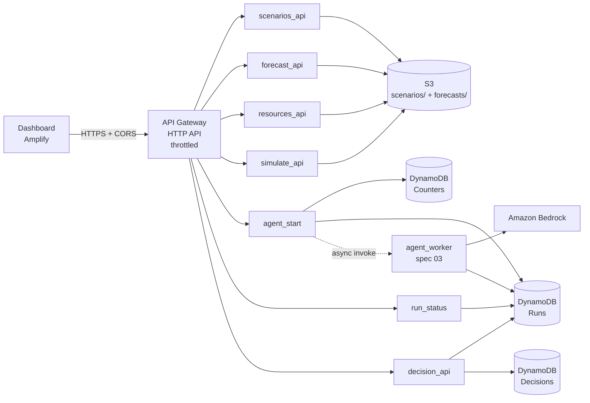

# Design: API backend

## Overview

Each route is a small Lambda that validates input, calls shared code in `backend/shared/` and returns JSON. Shared code holds everything that isn't HTTP glue: the data models, the simulator, config, a data store that reads scenarios and forecasts, and HTTP helpers. Handlers stay thin so the logic can be unit-tested without AWS.

Contracts for every request and response: #[[file:docs/contracts.md]]

## Architecture

- **AI vs plain code:** only `agent_worker` calls Bedrock. Every API Lambda here is plain code.
- **Async runs:** API Gateway times out at about 30 seconds, but an agent run can take minutes. So `agent_start` returns a `run_id` right away and invokes `agent_worker` with `InvocationType=Event`. The UI then polls `run_status`.

## Components

### `shared/api.py`: HTTP helpers

(It's named `api.py`, not `http.py`, so it can't be confused with Python's built-in `http` module.)

- `ok(body, status=200)` and `error(status, code, message)` build API Gateway v2 responses with a JSON body and `Content-Type: application/json`.
- `json_body(event)` decodes the body (including base64) and requires a JSON object. Otherwise it raises `ApiError(400, "BAD_REQUEST", …)`.
- `query_param(event, name)` reads a query string parameter.
- `valid_id(value, field)` enforces `^[a-z0-9_]{1,64}$`, so IDs can't contain `/` or `..` (no path traversal in local mode, no odd S3 keys).
- `api_handler` decorator: turns `ApiError` into its error response, and any other exception into `500 INTERNAL_ERROR` with a generic message. The traceback is logged with the Lambda request ID.
- CORS headers are added by API Gateway's CORS settings, not by the Lambdas.

### `shared/data.py`: data store

One interface with two backends, picked from config:

| Setting | Backend | Scenarios | Forecasts |
|---|---|---|---|
| `FORECAST_BUCKET` empty | `LocalStore` | `scenarios/{id}.json` in the repo | `forecasts/{id}.json` in the repo |
| `FORECAST_BUCKET` set | `S3Store` | `s3://bucket/scenarios/{id}.json` | `s3://bucket/{FORECAST_PREFIX}{id}.json` |

Methods: `list_scenario_ids()`, `get_scenario_raw(id)`, `get_forecast_raw(id)`. They return parsed JSON and raise `NotFound` (with the API error code) if the object doesn't exist. Stores re-check IDs themselves, as defense in depth.

`load_scenario(store, id)` and `load_forecast(store, id)` return `(raw, parsed)`. They raise `DataError` if the JSON is broken, breaks C1/C2, or a scenario file's `id` doesn't match its name. `DataError` becomes `500 DATA_ERROR`.

Scenarios live in S3 next to forecasts, not inside the Lambda package. That way P5 can update scenario values by uploading a file, without a redeploy.

### Handlers (`backend/functions/<name>/app.py`)

Each exposes `handler(event, context)`. The logic lives in a plain function that takes the store as an argument, so tests can pass a `LocalStore` pointed at a temporary folder.

| Function | Route | Owner |
|---|---|---|
| `scenarios_api` | `GET /scenarios` | P3 |
| `forecast_api` | `GET /forecast` | P1 (uses the same pattern) |
| `resources_api` | `GET /resources` | P3 |
| `simulate_api` | `POST /simulate` | P3 |
| `agent_start` | `POST /runs` | P3 |
| `run_status` | `GET /runs/{run_id}` | P3 |
| `decision_api` | `POST /runs/{run_id}/decision`, `GET /audit` | P3 |

### Packaging (SAM, `backend/template.yaml`)

- **`backend/shared/`** becomes a Lambda Layer laid out as `python/shared/…`, so handlers import `from shared.simulator import simulate_dict`, the same way the tests do.
- **Runtime:** `python3.12`, `arm64`. `boto3` comes from the Lambda runtime.
- **Environment variables:** set from the stack (table names, bucket, limits, model ID), matching `.env.example`.
- **Tables:** `Runs` (PK `run_id`), `Decisions` (PK `run_id`, SK `timestamp`), `Counters` (PK `day`). All on-demand billing.
- **Throttling:** stage default 20 req/s, burst 40. `POST /runs` 1 req/s, burst 2.

## Error handling

| Situation | Status | Code |
|---|---|---|
| Body not JSON, missing field, bad type or out of range | 400 | `BAD_REQUEST` |
| Unknown scenario / forecast / run | 404 | `SCENARIO_NOT_FOUND` / `FORECAST_NOT_FOUND` / `RUN_NOT_FOUND` |
| Decision on a run that isn't done | 409 | `RUN_NOT_DONE` |
| Daily cap reached | 429 | `DAILY_LIMIT_REACHED` |
| API Gateway throttling | 429 | (Gateway body: `{"message": "Too Many Requests"}`) |
| Stored scenario/forecast breaks C1/C2, or net demand ≤ 0 | 500 | `DATA_ERROR` |
| Anything else | 500 | `INTERNAL_ERROR` |

An invalid **plan** is not an HTTP error. `POST /simulate` returns `200` with `valid: false`, so the what-if panel can show the violations.

## Testing strategy

- **Unit tests** for `api.py` and `data.py`.
- **Handler tests** with fake API Gateway v2 events and a `LocalStore` on `tmp_path`. These cover success, every 400/404 path and the `DATA_ERROR` path.
- No AWS calls in tests. S3 and DynamoDB code paths are kept thin and checked with a smoke test after deploy.
- The existing pytest-on-save hook runs all of this.

## Decisions and trade-offs

- **One Lambda per route:** this matches the repo layout and gives least-privilege IAM per function. It costs a little more template code.
- **No caching:** each request reads S3 fresh (two small files, about 50 ms). That's simpler and always current.
- **IDs are validated before storage is touched:** this blocks path traversal and keeps S3 keys predictable.
