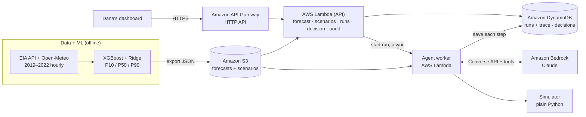

# GridGuard

**An AI planning assistant that helps a grid operator keep California's power on during a heat wave.**

An XGBoost model forecasts tomorrow's hourly electricity demand. An **Amazon Bedrock** agent (Claude) then drafts a plan to avoid blackouts, tests it in a plain-code simulator, revises it until every hour is safe, and writes a short briefing. A human operator has the final say.

> **The model predicts the peak. Amazon Bedrock plans, checks and fixes. Dana decides.**

Built in about 18 hours at **SpartHill Hacks 2026 (SJSU, AWS track)** with Amazon Bedrock, AWS serverless services and Kiro.

**Simulated only.** GridGuard never controls real equipment and never sends public alerts. Alerts are drafts for a human to review.

---

## Contents

- [The problem](#the-problem)
- [What GridGuard does](#what-gridguard-does)
- [Architecture](#architecture)
- [How the Bedrock agent works](#how-the-bedrock-agent-works)
- [Results](#results)
- [Scenarios and assumptions](#scenarios-and-assumptions)
- [Run your own copy](#run-your-own-copy)
- [API](#api)
- [Repo layout](#repo-layout)
- [Trust and safety by design](#trust-and-safety-by-design)
- [Limits and next steps](#limits-and-next-steps)
- [Built with Kiro](#built-with-kiro)
- [Team](#team)
- [Data sources](#data-sources)

---

## The problem

On **September 6, 2022**, California's grid hit an all-time record of **51,426 MW** at 4:55 p.m. ([EIA](https://www.eia.gov/todayinenergy/detail.php?id=54039)). The grid operator (CAISO) declared **Energy Emergency Alert 3**, the last step before rolling blackouts. About an hour later, the state sent an emergency text to phones across California asking people to save power. Within five minutes, demand fell more than **2,100 MW** below CAISO's hour-ahead forecast. There were no rolling blackouts.

Evenings are the danger: it is still hot, but solar power fades at sunset.

### Persona: Dana Ruiz (fictional)

Dana is the heat-wave shift lead at a California grid operator. On a hot morning she has a few hours to decide when to use batteries, which buildings to pre-cool through utility programs, and whether to request a public alert. Too little action risks blackouts. Too much, and people stop trusting alerts.

Dana needs:
- an **early warning** of which hours are at risk,
- a **plan with numbers** that has already been tested,
- the **reasons** behind it and what could still go wrong,
- the **final say** on anything public.

---

## What GridGuard does

1. **Forecast:** an XGBoost model predicts tomorrow's demand hour by hour, with a best case (P10), a median (P50) and a worst case (P90).
2. **Plan:** Dana clicks **Make a plan**. A Bedrock agent reads the forecast and the available resources, then proposes a plan using the least disruptive actions first: battery → pre-cooling → demand response → a public alert only as a last resort.
3. **Check and revise:** every plan is tested in a plain-Python simulator. If any hour is short, the agent revises and tests again, up to 5 times.
4. **Brief:** the agent writes a short briefing: the actions, why, what could go wrong, and a draft public alert if one is needed.
5. **Decide:** Dana approves, edits or rejects. Every decision is logged.

If the target can't be reached, the agent says so (`CANNOT_MEET_TARGET`) instead of pretending.

---

## Architecture


<details>
<summary>Text version of the diagram</summary>



</details>

| Part | Service | What it does |
|---|---|---|
| Forecast | XGBoost + Ridge (Python, trained offline) | Hourly P10/P50/P90 demand for each scenario |
| Storage | **Amazon S3** | Forecast and scenario JSON files |
| API | **Amazon API Gateway** (HTTP API) + **AWS Lambda** (Python 3.12, arm64) | Forecast, scenarios, runs, decisions, audit |
| Agent | **AWS Lambda** worker + **Amazon Bedrock** (Claude, Converse API with tool use) | Plans, simulates, revises, writes the briefing |
| Simulator | Plain Python, unit-tested | Margin and status for every hour, rule checks |
| Database | **Amazon DynamoDB** | Runs with a step-by-step trace, decisions (audit log), daily run counter |
| Infrastructure | **AWS SAM** (CloudFormation) | One stack, `gridguard`, in `us-east-1` (ran live during the hackathon) |
| Frontend | Single-page demo (`demo/index.html`) and a React + Vite app (`frontend/`) | Forecast chart, live agent run, briefing, approval |
| Build tool | **Kiro** | Steering files, specs, hooks |

---

## How the Bedrock agent works

The agent lives in [`backend/functions/agent_worker/app.py`](backend/functions/agent_worker/app.py). It runs a **Bedrock Converse tool-use loop** with four tools, all backed by our own code:

| Tool | Returns |
|---|---|
| `get_forecast` | Peak P90 demand and its hour, plus the 24 hourly P90 values |
| `get_resources` | Battery, pre-cool, demand-response and public-alert limits, the margin target, solar and wind supply |
| `simulate(plan)` | Whether the plan is valid, which hours are RED or YELLOW, the lowest margin, and how many MW each short hour still needs |
| `submit_plan(plan, status, rationale, risks, alert_text)` | Accepts the plan only if it passes the submit gate (below) |

**The loop:**
1. The agent must call `get_forecast` and `get_resources` first.
2. It proposes a plan and calls `simulate`.
3. If any hour isn't GREEN, it revises and simulates again.
4. It calls `submit_plan` with an honest status: `ALL_GREEN` or `CANNOT_MEET_TARGET`.

**Guardrails in code:**
- **Submit gate:** the server hashes the plan (SHA-256 of canonical JSON) and accepts it only if that exact plan was simulated in this run and the result matches the claimed status. A hash from the model is never trusted.
- **Step limits:** at most 5 simulations and 12 tool calls. If the agent hits the limit, the server submits its best valid plan as `CANNOT_MEET_TARGET`.
- **Numbers come from code:** the system prompt forbids stating any number that didn't come from a tool. The action table in the briefing is built by the server from the accepted plan.
- **Alerts are drafts only**, at most 160 characters, and labelled "Draft only. Not sent."
- **Live progress:** every tool call and result is saved to DynamoDB as it happens, so the dashboard shows each attempt live.

Status per hour: **GREEN** = margin at or above target (6%), **YELLOW** = between 0% and the target, **RED** = below 0% (supply short).

---

## Results

### Forecast accuracy (2022, never used in training)

Trained on 2019–2021, tested on all of 2022. Full table: [`docs/forecast_eval.md`](docs/forecast_eval.md).

| Period | Our MAPE (P50) | CAISO day-ahead MAPE | "Same hour last week" MAPE | P10–P90 coverage |
|---|---:|---:|---:|---:|
| All 2022 | **3.17%** | 3.56% | 6.79% | 73.3% |
| Summer 2022 (Jun–Sep) | **3.61%** | 4.18% | 9.87% | 61.7% |

**Sept 6, 2022 (the record day):**

| | Value |
|---|---|
| Actual hourly peak | 51,104 MW at hour 18 |
| Our P50 peak | 48,432 MW at hour 16 (**−5.2%**) |
| Our P90 peak | 51,876 MW at hour 16 (above the actual peak) |

**Note:** we trained with *actual* temperatures, while CAISO forecasts with *forecast* temperatures, so this isn't a like-for-like comparison. Real-world error would be higher. Our P50 under-predicts record days, which is why the agent always plans on the **P90**.

**What made the record day work:** tree models can't predict above the highest value they saw in training, and Sept 6, 2022 was an all-time record. Our first XGBoost-only model missed the peak by −11%. Adding a **Ridge linear base** (which can extrapolate with temperature) under XGBoost **quantile residual** models cut that to −5.2%. **Conformal calibration by heat bucket** then widened the bands on hot hours. The same fix makes the +5°F scenario realistic: its peak rises by about 4,500 MW.

### Agent results (live on Amazon Bedrock)

LLM runs vary slightly from run to run. These are typical results.

**Sept 6, 2022 → `ALL_GREEN` in 3 attempts, no public alert needed**

| Attempt | Result |
|---|---|
| 1 | RED at 7–9 p.m., lowest margin −4.99% at 8 p.m. (solar fading) |
| 2 | Battery + demand response + pre-cooling: no RED, YELLOW at 4 p.m. and 9 p.m. |
| 3 | Adjusted battery and pre-cool: **all 24 hours GREEN**, lowest margin about 6.1% |

**Sept 6, 2022 + 5°F → honest `CANNOT_MEET_TARGET` after 4 attempts**

| Attempt | Lowest margin |
|---|---:|
| 1 | −10.21% |
| 2 | −3.29% |
| 3 | −0.41% |
| 4 | **+0.28%** (no RED hours, but below the 6% target) |

The agent used every resource in order, drafted a calm public alert for 7–10 p.m. (the same last-resort action California took on the real night), and reported that the target couldn't be met.

### Tests

**159 tests pass** (`python -m pytest -q`): simulator rules and math, models and contracts, config, API handlers, run storage and the submit gate, decisions, and the agent loop with a fake Bedrock client.

---

## Scenarios and assumptions

Three scenarios live in [`scenarios/`](scenarios/), built by [`ml/build_scenarios.py`](ml/build_scenarios.py). Every value has a source or an `ASSUMPTION` label in the file's `sources` map.

| Scenario | Forecast | No-action result |
|---|---|---|
| `sept6_2022` | Real Sept 6, 2022 conditions | RED 6–9 p.m. |
| `sept6_2022_plus5f` | Same day, every city +5°F | RED 3–10 p.m. |
| `normal_summer_day` | 2022-07-28 (typical July weekday) | All GREEN |

| Resource | Value | Basis |
|---|---|---|
| Solar and wind by hour | EIA actuals for the date | Source |
| Firm supply | 43,690 MW | Estimated from EIA actuals at the peak hour, plus a tuned cushion (demo calibration, not a measured figure) |
| Battery | 3,900 MW / 15,600 MWh, 90% charged, 85% efficiency | Power: E Source (CAISO had more than 3,900 MW of batteries in Sept 2022). Energy: ASSUMPTION (4-hour batteries) |
| Pre-cooling | Up to 1,000 MW moved from 5–8 p.m. to 1–4 p.m., 30% rebound | ASSUMPTION |
| Demand response | Utility DR 1,200 MW (max 4 h, 4–9 p.m.) · Emergency Load Reduction 500 MW (max 3 h, 5–9 p.m.) | ASSUMPTION |
| Public alert | Reduces demand by 1,000 MW (low, used by the simulator), max 3 h | Cal Advocates (2,000 MW drop), EIA (more than 2,100 MW), E Source (2,400 MW) |
| Safety margin target | 6% | ASSUMPTION |

The simulator always plans against the **P90** demand and the **low** alert estimate, to stay conservative.

---

## Run your own copy

During the hackathon, GridGuard ran live on AWS in `us-east-1`. The event account has since been removed, so to try it you deploy your own copy.

**You need:** Python 3.12, AWS CLI v2, AWS SAM CLI, and an AWS account with Amazon Bedrock access to a Claude model in `us-east-1`.

**1. Run the tests (no AWS needed)**
```bash
python -m venv .venv && source .venv/bin/activate      # Windows: .venv\Scripts\activate
pip install -r backend/requirements-dev.txt
python -m pytest -q
```

**2. Run the agent locally against Amazon Bedrock**
```bash
python scripts/run_agent_local.py --scenario sept6_2022          # expect ALL_GREEN
python scripts/run_agent_local.py --scenario sept6_2022_plus5f   # expect CANNOT_MEET_TARGET
```

**3. Deploy to AWS and open the dashboard**
```bash
cd backend
sam build && sam deploy --parameter-overrides AgentWorker=bedrock BedrockModelId=us.anthropic.claude-sonnet-5-5
aws s3 cp ../forecasts/ s3://<DataBucketName>/forecasts/ --recursive
aws s3 cp ../scenarios/ s3://<DataBucketName>/scenarios/ --recursive
```
Set the `API` constant in `demo/index.html` to your stack's `ApiUrl` output, then serve it with `python -m http.server 5173 --bind 127.0.0.1` from the `demo/` folder and open **http://localhost:5173**.

<details>
<summary>Rebuild the forecasts and scenarios from raw data (optional)</summary>

Needs a free [EIA API key](https://www.eia.gov/opendata/) in `.env` as `EIA_API_KEY=...`.

```bash
pip install pandas pyarrow requests xgboost scikit-learn holidays python-dotenv joblib
python ml/fetch_eia.py && python ml/fetch_weather.py && python ml/build_features.py
python ml/train.py && python ml/evaluate.py
python ml/export_forecasts.py && python ml/build_scenarios.py
```
</details>

---

## API

Base URL: the `ApiUrl` stack output. Data shapes are defined in [`docs/contracts.md`](docs/contracts.md) (C1–C6).

| Endpoint | What it does |
|---|---|
| `GET /scenarios` | List scenarios |
| `GET /forecast?scenario={id}` | Hourly P10/P50/P90, actual and CAISO forecast (C1) |
| `GET /resources?scenario={id}` | Full scenario with sources (C2) |
| `POST /simulate` | Test a plan in the simulator (plain code, no AI) |
| `POST /runs` `{"scenario_id": "sept6_2022"}` | Start an agent run → `{run_id, status: "running"}` |
| `GET /runs/{run_id}` | Run status, step-by-step trace, simulations, final plan and briefing |
| `POST /runs/{run_id}/decision` `{operator_name, decision, note?}` | Record APPROVE / EDIT / REJECT |
| `GET /audit` | Decisions, newest first |

Limits: a daily cap on runs (default 100), stricter throttling on `POST /runs`, and runs older than 6 minutes reported as timed out.

---

## Repo layout

```
.kiro/
  steering/          product.md, tech.md, rules.md (loaded into every Kiro session)
  specs/             04-api-backend (requirements, design, tasks)
  hooks/             run pytest when backend or test files are saved
ml/                  data fetch, features, training, evaluation, export, scenario builder
forecasts/           3 forecast files (C1)
scenarios/           3 scenario files with sources (C2)
backend/
  template.yaml      AWS SAM stack
  shared/            simulator, models, runs, decisions, briefing, data store, API helpers, config
  functions/         one folder per Lambda (forecast, scenarios, resources, simulate,
                     agent_start, run_status, agent_worker, agent_worker_stub, decision)
demo/index.html      single-page dashboard used in the video
frontend/            React + Vite + TypeScript dashboard
scripts/             run_agent_local.py
tests/               pytest suite (159 tests)
docs/                contracts, forecast evaluation, architecture diagram
tasks.md             team plan, task owners and contracts
```

---

## Trust and safety by design

- **Human in the loop:** nothing happens without Dana's decision. Every decision is stored with the operator name and time.
- **Simulated only:** no connection to real equipment. Public alerts are drafts.
- **Numbers from code:** forecasts and simulator results are the only source of numbers. The AI chooses actions; code checks them.
- **No untested plans:** the submit gate refuses any plan that wasn't simulated in the same run.
- **Honest failure:** `CANNOT_MEET_TARGET` is a first-class result, with the remaining risk explained.
- **Labelled assumptions:** every scenario value has a source or an `ASSUMPTION` label.
- **No secrets in the repo:** AWS credentials come from the AWS profile, and the EIA key from SSM Parameter Store or a git-ignored `.env`.
- **Least-privilege IAM:** each Lambda gets only the permissions it needs. Only the agent worker can call Bedrock.

---

## Limits and next steps

**Limits**
- Trained with actual temperatures; a production system would use weather forecasts.
- P10–P90 coverage was 62% in summer 2022 (target 80%), because 2022 was hotter than the calibration data.
- Battery, pre-cool and demand-response sizes are assumptions, and the firm-supply figure is a demo calibration.
- The simulator is a single-node, hourly margin model. It doesn't model transmission limits, imports or battery recharging.
- Demo security only (rate limits and a daily cap); production would add authentication (for example Amazon Cognito).

**Next steps**
- Number guard: automatically check every number in the briefing against tool outputs (`backend/shared/number_guard.py`).
- Agent evaluation suite with 10+ cases (`eval/`).
- Amazon Bedrock Guardrails on the briefing and alert text.
- What-if screen (temperature and margin sliders) and an audit-log screen.
- Forecast with weather forecasts, and add more heat-wave days.

---

## Built with Kiro

- **Steering files** (`.kiro/steering/`) gave every teammate's Kiro the same product context, stack and rules (for example: "never train on 2022 data", "every number must come from the forecast or simulator").
- **Specs** (`.kiro/specs/04-api-backend/`) took the API from requirements to design to tasks.
- **Hooks** (`.kiro/hooks/`) run the test suite automatically when backend code is saved.
- Shared **contracts** (`docs/contracts.md`) let five people build in parallel against mock data.

---

## Team

| Name | Role |
|---|---|
| Snehil Raut | ML forecast, scenarios, Bedrock agent, demo page, AWS deploymen |
| Shivani Jariwala | Backend, simulator, API |

---

## Data sources

- [EIA API v2](https://www.eia.gov/opendata/): CAISO hourly demand, day-ahead forecast, solar and wind generation
- [Open-Meteo historical weather API](https://open-meteo.com/): hourly temperatures for Los Angeles, Riverside, Fresno, Sacramento and San Jose
- [EIA: California consumers respond to appeals for electricity conservation (Sept 28, 2022)](https://www.eia.gov/todayinenergy/detail.php?id=54039)
- [Cal Advocates: September 2022 heat wave analysis](https://www.publicadvocates.cpuc.ca.gov/-/media/cal-advocates-website/files/press-room/reports-and-analyses/220922-caladvocates-sept-22-heat-wave-analysis---executive-summary.pdf)
- [E Source: How CAISO prevented a mass outage during the 2022 heat wave](https://www.esource.com/printpdf/220436)
